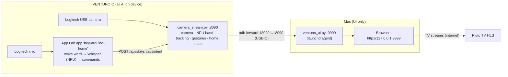

# Sign & Say — Getting Started

**Sign & Say (Smart Home Mobility Project)** controls a simulated smart home — lighting, temperature and TV — with
hand gestures and offline voice commands. All AI runs locally on an **Arduino VENTUNO Q** (Qualcomm QCS8275,
Hexagon NPU): hand tracking with MediaPipe models exported through **ExecuTorch / QNN**, the "Hey Arduino" keyword
spotter and **Whisper** speech recognition. A Mac only shows the UI.

---

## 1. How it fits together



| Runs on | Component | What it does |
|---|---|---|
| VENTUNO Q | `device/handpose/camera_stream.py` | Camera MJPEG stream, NPU hand tracking (palm + 21-point landmarks + face filter), thumbs up / down, home state, voice + gesture pairing, HTTP API on port 8090 |
| VENTUNO Q | `device/voice_app/hey-arduino-home` | App Lab app: "Hey Arduino" / "Hey Ardy" wake word, Whisper Small on the NPU, command parsing |
| Mac | `mac/ventuno_ui.py` + `mac/index.html` | Starts when the board is plugged in, forwards the board's API over `adb`, serves the house UI |
| Mac browser | `hls.js` | Plays the Pluto TV channels inside the camera window |

---

## 2. Requirements

**Hardware**
- Arduino VENTUNO Q (Ubuntu 24.04, Arduino App Lab installed)
- Logitech USB webcam with built-in microphone, plugged into the board
- Mac connected to the board with a USB-C cable

**Mac software**
- macOS with the system `python3` (`/usr/bin/python3`)
- `adb`: `brew install android-platform-tools`
- A browser (Chrome or Safari)

**Board software** (already present on a provisioned board)
- ExecuTorch with the Qualcomm backend at `/home/arduino/QualcommDeveloper/executorch`
- Python venv at `/home/arduino/handpose/.venv`
- Exported models in `/home/arduino/handpose/export/pte/`

---

## 3. Repository layout

```
ExecuTorch-Hack-1/
├── Documentation/            this guide
├── mac/
│   ├── install.sh            installs / updates the Mac UI agent
│   ├── ventuno_ui.py         USB watcher + UI server (port 9999)
│   ├── index.html            the house UI
│   └── hls.min.js            TV stream player
├── device/
│   ├── handpose/             runs on the board in /home/arduino/handpose/src
│   │   ├── camera_stream.py  home server (port 8090)
│   │   ├── hand_tracker.py   NPU hand tracking (persistent qnn_executor_runner processes)
│   │   ├── gestures.py       thumbs up / down classifier + 3 s state
│   │   ├── run_home_server.sh  starts the server if it isn't running (cron + Mac agent)
│   │   ├── env.sh            environment for export / test scripts
│   │   ├── step0_check.py … step2_export.py, export_face.py   model export pipeline
│   │   └── test_*.py, probe_false_hands.py                   tests and diagnostics
│   └── voice_app/hey-arduino-home/   App Lab app (python/ + sketch/ + app.yaml)
├── results/                  reports and sample outputs from setup steps
└── third_party/              upstream model code (MediaPipePyTorch, App Lab examples)
```

---

## 4. Quick start (board already set up)

1. **Plug in** the camera to the VENTUNO Q, and the VENTUNO Q to the Mac with USB-C.
2. **Check the board is visible:**
   ```bash
   adb devices          # the board shows up as "device"
   ```
3. **Install the Mac UI** (once, and again after any change under `mac/` or `device/handpose/`):
   ```bash
   cd ExecuTorch-Hack-1
   bash mac/install.sh
   ```
   This installs a launchd agent (`com.ventuno.home-ui`) that starts at login, waits for the board, pushes the
   current device scripts to it, restarts the board server if its version is out of date, and opens
   **http://127.0.0.1:9999**.
4. **Check the status pills** at the top of the page: *VENTUNO Q: connected*, *Camera: ~30 fps*, *Gesture* and
   *Voice*.
5. **Make sure the voice app is running** on the board:
   ```bash
   adb shell arduino-app-cli app list | grep hey-arduino-home     # STATUS should be "running"
   adb shell arduino-app-cli app start user:hey-arduino-home      # if it isn't
   ```

The board server also starts on its own at boot and is checked every minute by cron, so gestures and voice work
even without the Mac connected.

---

## 5. Using it

### Voice commands

Start every command with **"Hey Arduino"** or **"Hey Ardy"**, then say the command in the same breath.

| Section | Examples |
|---|---|
| Lighting | "turn on the light", "turn off the lights", "lights 40", "set the lights to 30 percent", "dim the lights", "brighter" |
| Temperature (°F) | "set the temperature to 70", "set the temperature to 22 celsius", "warmer", "cooler", "turn off the heating" |
| TV | "turn on the TV", "turn off the TV", "channel 2", "go to channel 3", "comedy", "sci fi", "action", "next channel", "volume 20", "louder" |
| Combined | "turn on the lights and the TV" |

- Temperature targets are limited to 50–86 °F.
- Channel changes need the TV on. If it's off, the TV section shows **"TV is off"**.
- The *Voice* pill shows what Whisper heard and what happened.

### Hand gestures

| Gesture | Shown as | Notes |
|---|---|---|
| Thumbs up | 👍 badge on the camera | Held state lasts 3 s, then resets to *none* |
| Thumbs down | 👎 badge on the camera | Switching up ↔ down updates instantly |

The hand skeleton (21 points per hand, up to 2 hands) is drawn over the camera. Use the **Hand skeleton** button
to hide it.

### Voice + gesture (lighting)

Say **"Hey Arduino, light"** (or "Hey Ardy, light") and show a thumb within **3 seconds**, before or after
speaking:

- 👍 thumbs up → lights **on**
- 👎 thumbs down → lights **off**

While waiting, the Voice pill shows *"Lights: show 👍 for on or 👎 for off"*. A thumb you are already holding
counts too. Tip: keep your thumb up or down until the Lighting section changes, because the speech is matched when
Whisper finishes transcribing. Spoken commands like "turn on the light" work without a gesture.

### TV channels

| # | Name | Source |
|---|---|---|
| 1 | Comedy | Pluto TV |
| 2 | Sci Fi | Pluto TV |
| 3 | Action | Pluto TV |

When the TV is on, the channel plays inside the camera window. Turning the TV off brings the camera back and resets
hand tracking and gestures. The TV video needs internet access on the Mac.

### Buttons

Each room also has on-screen controls (on/off, brightness slider, ±1 °F, CH − / CH +). Changes from buttons,
voice and gestures all stay in sync.

---

## 6. Making changes and deploying

| You changed | Deploy with |
|---|---|
| `mac/*` (UI) | `bash mac/install.sh`. Open tabs reload automatically. |
| `device/handpose/camera_stream.py`, `hand_tracker.py`, `gestures.py` | Bump `STREAM_VERSION` in `camera_stream.py`, then `bash mac/install.sh`. The agent pushes the files and restarts the board server. |
| Voice app (`device/voice_app/hey-arduino-home/...`) | Push and restart (below). |

```bash
cd device/voice_app/hey-arduino-home
adb push python/*.py /home/arduino/ArduinoApps/hey-arduino-home/python/
adb push app.yaml /home/arduino/ArduinoApps/hey-arduino-home/
adb shell arduino-app-cli app restart user:hey-arduino-home
```

> The Mac agent runs an **installed copy** in `~/Library/Application Support/VentunoHome`, not the files in the
> repo. Edits only take effect after `bash mac/install.sh`.

---

## 7. Tests

```bash
# Voice command parser (runs anywhere with Python 3)
cd device/voice_app/hey-arduino-home/python && python3 test_commands.py

# On the board: gesture rules and voice + gesture timing
adb shell 'cd /home/arduino/handpose/src && ../.venv/bin/python test_gestures.py --rules'
adb shell 'cd /home/arduino/handpose/src && ../.venv/bin/python test_gestures.py --fusion'

# On the board: what the tracker accepts on the live feed (saves annotated frames to /tmp/probe)
adb shell 'cd /home/arduino/handpose/src && ../.venv/bin/python probe_false_hands.py 30 /tmp/probe'
```

---

## 8. First-time board setup (from scratch)

Only needed for a fresh board. Run model and export scripts on the board with the environment sourced:

```bash
adb shell
cd /home/arduino/handpose/src && source env.sh
```

1. **Copy the device code** from the repo to the board:
   ```bash
   adb shell mkdir -p /home/arduino/handpose/src
   adb push device/handpose/. /home/arduino/handpose/src/
   ```
   Place the model code under `/home/arduino/handpose/third_party/MediaPipePyTorch` (BlazePalm, hand landmark and
   BlazeFace weights + anchors). Install Python packages into `/home/arduino/handpose/.venv` from
   `/home/arduino/handpose/reqs.txt` (with `constraints.txt`).
2. **Check the toolchain**: `python step0_check.py` confirms the NPU (HTP V75), the QNN runner and ExecuTorch export.
3. **Fetch the models and calibration data**: `python step1_models.py`
4. **Export the hand models** (XNNPACK fp32 + QNN 16a8w) and compare them with PyTorch: `python step2_export.py`
5. **Export the face filter** (with `camera_stream.py` running, since it calibrates on live frames):
   `python export_face.py`
6. **Start the home server automatically** with cron (`crontab -e` as `arduino`):
   ```
   @reboot sleep 20; /bin/bash /home/arduino/handpose/src/run_home_server.sh
   * * * * * /bin/bash /home/arduino/handpose/src/run_home_server.sh
   ```
7. **Install the voice app**:
   ```bash
   adb push device/voice_app/hey-arduino-home /home/arduino/ArduinoApps/
   adb shell arduino-app-cli app start user:hey-arduino-home
   ```
8. On the Mac: `bash mac/install.sh`.

Exported models end up in `/home/arduino/handpose/export/pte/`:
`mp_palm_detector_qnn_16a8w.pte`, `mp_hand_landmark_qnn_16a8w.pte`, `mp_face_detector_qnn_16a8w.pte` (plus
XNNPACK and RTMPose variants for comparison).

---

## 9. Troubleshooting

| Symptom | Check |
|---|---|
| UI says *VENTUNO Q: disconnected* | `adb devices`; replug USB-C; `tail ~/Library/Application\ Support/VentunoHome/logs/ui.log` |
| Page doesn't load at :9999 | `launchctl kickstart -k gui/$(id -u)/com.ventuno.home-ui`, or re-run `bash mac/install.sh` |
| Camera pill shows an error or 0 fps | Board log: `adb shell tail -50 /home/arduino/handpose/logs/camera_stream.log`; check the camera is on `/dev/video0` |
| UI changes don't show up | Re-run `bash mac/install.sh` (the agent runs an installed copy) |
| Board server runs old code | Bump `STREAM_VERSION` in `camera_stream.py`, then `bash mac/install.sh` |
| Voice does nothing | `adb shell arduino-app-cli app logs user:hey-arduino-home \| tail -30` shows every wake word, what Whisper heard and the result |
| "Hey Ardy" sometimes missed | The wake-word model is trained on "Hey Arduino"; "Hey Ardy" is accepted at lower confidence and confirmed from the transcript. Say it clearly, followed straight away by the command. |
| Commands misheard in a noisy room | Speak close to the camera; nearby conversation gets transcribed too. The log shows what was heard. |
| TV shows "Where to watch" or stays black | The Mac needs internet; Pluto TV streams are US-only. |
| Skeleton on a face | The face filter needs `mp_face_detector_qnn_16a8w.pte` on the board (run `export_face.py`). |

### Board HTTP API (port 8090, or 18090 on the Mac through the adb forward)

| Method | Path | Purpose |
|---|---|---|
| GET | `/health` | Camera fps, hand tracker status, server version |
| GET | `/stream.mjpg`, `/snapshot.jpg` | Camera video / single frame |
| GET | `/hands`, `/hands.sse` | Hand landmarks (latest / live stream) |
| GET | `/gesture` | Current gesture state (`thumbs_up`, `thumbs_down`, `none`) |
| GET / POST | `/api/state` | Home state (lighting, temperature, TV) / change it |
| GET | `/api/events` | Live state, voice and gesture changes (server-sent events) |
| POST | `/api/voice` | Voice app status updates |
| POST | `/api/intent` | Bare "light" waiting for a thumbs up / down |

Example:
```bash
curl -s http://127.0.0.1:9999/api/state
curl -s -X POST -H 'Content-Type: application/json' -d '{"lighting": {"on": true}}' http://127.0.0.1:9999/api/state
```
