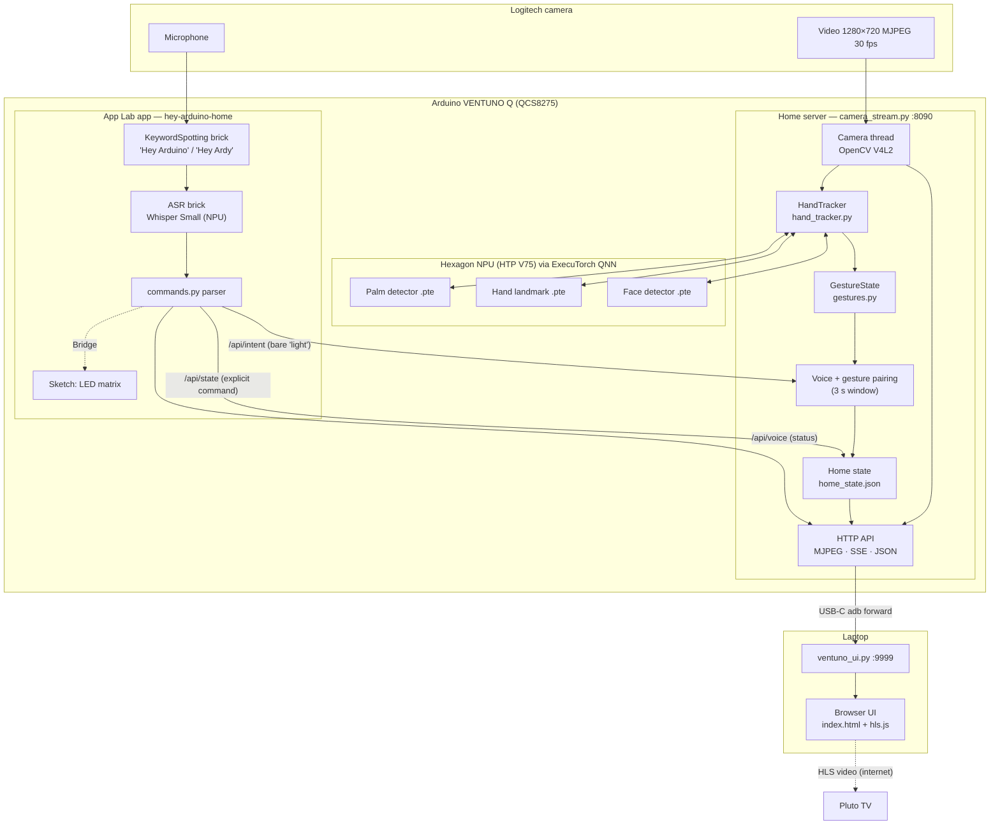
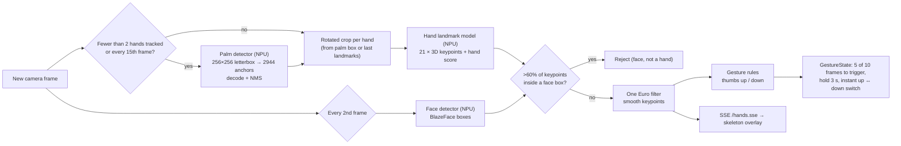
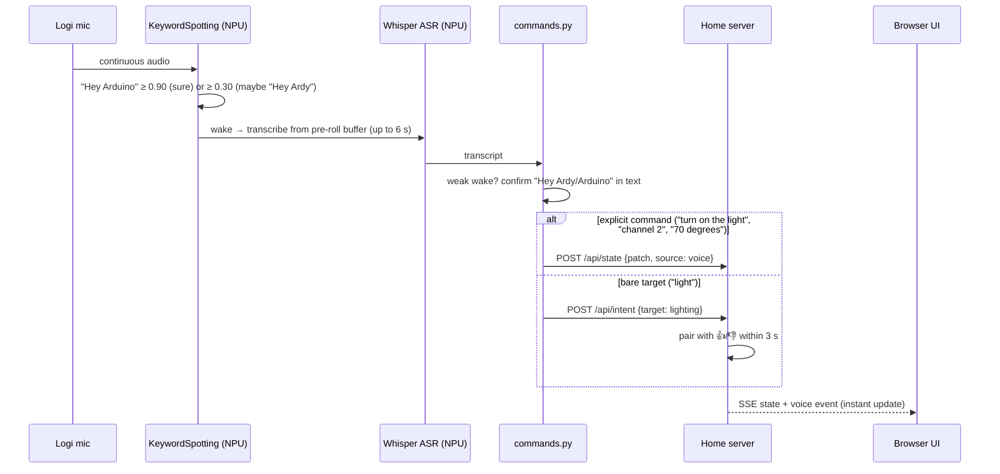
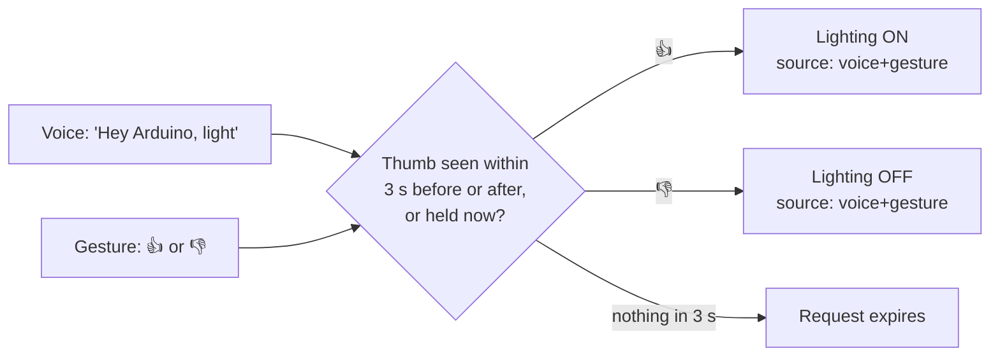
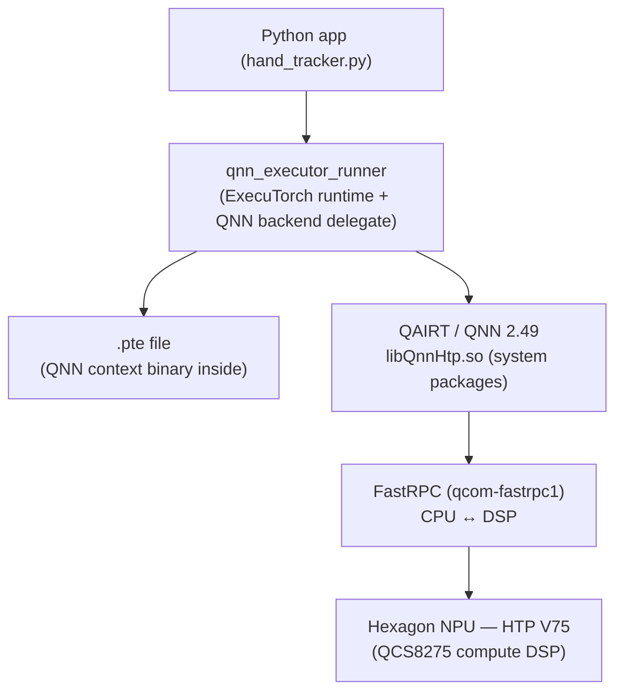
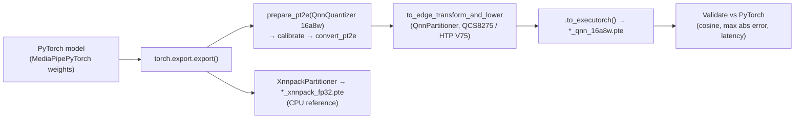

# Sign & Say — Architecture

**Sign & Say (Smart Home Mobility Project)** controls a simulated home (lighting, temperature, TV) with hand gestures
and offline voice commands. All AI inference runs on the **Arduino VENTUNO Q**, mostly on its **Qualcomm Hexagon
NPU**. The laptop only displays the UI.

See [GETTING_STARTED.md](GETTING_STARTED.md) for setup and usage.

Full-size diagram: [SVG](architecture_diagram.svg) · [PDF](architecture_diagram.pdf) · [PNG](architecture_diagram.png)

---

## **1. Project Components**

The system has three physical parts.

### **1.1 Logitech Camera Unit**

| | |
|---|---|
| Connection | USB, plugged into the VENTUNO Q (not the laptop) |
| Video | `/dev/video0`, 1280×720 MJPEG at 30 fps, read with OpenCV (V4L2) |
| Audio | Built-in microphone, used by the voice app as a standard ALSA capture device |
| Role | The only input sensor: hands for gestures, voice for commands |

The camera's MJPEG frames are passed through to the UI as they are (no re-encoding) and decoded once for hand
tracking.

### **1.2 Arduino VENTUNO Q Board**

| | |
|---|---|
| SoC | Qualcomm **QCS8275**: Kryo CPU, Adreno GPU, **Hexagon NPU (HTP V75)** |
| OS | Ubuntu 24.04 LTS (aarch64) |
| AI runtime | **ExecuTorch** (Qualcomm QNN backend) + **QAIRT / QNN 2.49** (system packages) |
| App platform | **Arduino App Lab** (`arduino-app-cli` 0.13), apps run as Docker containers with "bricks" |
| Microcontroller side | Runs the App Lab sketch (`sketch.ino`), which drives the LED matrix to show voice state |
| Role | Does everything: camera capture, hand tracking, gesture recognition, wake word, speech recognition, command parsing, voice + gesture pairing, and home state |

The board runs two independent pieces of software:

1. **Home server** (`device/handpose/camera_stream.py`, port 8090): camera, NPU hand tracking, gestures,
   home state, HTTP API. Started at boot by cron through `run_home_server.sh`.
2. **Voice app** (`device/voice_app/hey-arduino-home`, App Lab app): wake word + Whisper on the NPU, command
   parsing. Sends results to the home server over HTTP.

### **1.3 UI Running in the Laptop Browser**

| | |
|---|---|
| Host | macOS laptop connected to the board with USB-C |
| Agent | `mac/ventuno_ui.py`, a launchd agent (`com.ventuno.home-ui`) using only the Python standard library |
| Transport | `adb forward tcp:18090 → tcp:8090` over USB (no network needed between laptop and board) |
| Page | `mac/index.html` at **http://127.0.0.1:9999**: a 2D house with a roof (with chimney smoke), Lighting, Temperature and TV rooms |
| Live data | MJPEG video, hand landmarks over server-sent events (SSE), home state and voice/gesture events over SSE |
| TV | `hls.js` plays the Pluto TV channel inside the camera window |

The laptop runs **no AI**. It watches for the board on USB, sets up the port forward, pushes the latest device
scripts, and relays HTTP between the browser and the board.

---

## **2. Program Flow Diagram**

### **2.1 System Overview**

### **2.2 Per-Frame Hand Tracking Loop**

### **2.3 Voice Command Flow**

### **2.4 Voice + Gesture Pairing (Lighting)**

---

## **3. Hand Gesture Detectors (Inference Models)**

### **3.1 Models**

All neural models take an RGB float32 tensor `(1, 3, 256, 256)` in `[0, 1]` (letterboxed), and were exported to
ExecuTorch `.pte` files on the board itself.

| Model | Origin | Purpose | Outputs | Live? |
|---|---|---|---|---|
| **MediaPipe BlazePalm** (palm detector) | Google MediaPipe, PyTorch port `zmurez/MediaPipePyTorch` (the version pinned by **Qualcomm AI Hub**) | Find hands (palm boxes + 7 keypoints) | `1×2944×18` boxes, `1×2944×1` scores | Yes |
| **MediaPipe BlazeHandLandmark** | same | 21 3D keypoints per hand from a rotated crop | hand flag, handedness, `1×21×3` landmarks | Yes |
| **MediaPipe BlazeFace (back, 256×256)** | same | Find faces so they aren't mistaken for hands | `1×896×16` boxes, `1×896×1` scores | Yes |
| **RTMPose-m hand** (`rtmpose-m_hand5_256`) | OpenMMLab RTMPose | Alternative 21-keypoint model, kept for comparison | SimCC x/y heatmaps | No (benchmark only) |

### **3.2 Gesture Classifiers (Rule-Based)**

Thumbs up and thumbs down are **not** separate neural networks. They are geometric rules on the 21 NPU
landmarks in `gestures.py`, so no training data is needed and they work at any hand size or position:

- **Thumb**: straight (joint bends < 45° / 55°), long (> 0.45 × palm size), pointing within 60° of vertical,
  and its tip clearly beyond the knuckles, wrist and fist center.
- **Fist**: at least 3 of the 4 fingers curled and none clearly pointing out (loose or tight fists both work).
- **Direction**: the same test with direction −1 (up) or +1 (down).

`GestureState` turns per-frame results into a stable state: a gesture triggers when it matches **5 of the last 10
frames** (~0.33 s), stays set for **3 seconds**, then resets to *none*. Switching from 👍 to 👎 (or back) takes
over immediately.

---

## **4. How the Models Are Integrated in the Software**

| Layer | File | What it does |
|---|---|---|
| Camera | `camera_stream.py` (`Camera` thread) | Reads MJPEG frames with OpenCV, keeps the latest JPEG for streaming |
| NPU runners | `hand_tracker.py` (`QnnModel`) | Starts one **persistent `qnn_executor_runner` process per model** (`--input_list_path=-`). The QNN context stays loaded on the NPU; each frame is written as raw float32 to `/dev/shm` and requested with one stdin line. Outputs are read back as raw files. |
| Tracking | `hand_tracker.py` (`HandTracker`) | MediaPipe-style loop: palm detector only while < 2 hands are tracked (plus every 15 frames), landmark model on a rotated crop that follows the previous landmarks, bigger retry crops for fists, face rejection, One Euro smoothing |
| Gestures | `gestures.py` | Rule-based thumbs up / down + `GestureState` timing |
| Pairing + state | `camera_stream.py` (`Home`) | Holds lighting / temperature / TV state, pairs bare "light" voice requests with gestures (`FUSION_S = 3.0`), checks TV-off rules, saves `home_state.json` |
| API | `camera_stream.py` (HTTP server) | `/stream.mjpg`, `/hands.sse`, `/gesture`, `/api/state`, `/api/intent`, `/api/voice`, `/api/events`, `/health`. Also listens on the `docker0` bridge so App Lab containers can reach it. |
| Voice | `voice_app/.../main.py`, `asr_session.py`, `mic_preroll.py`, `commands.py` | Wake word → Whisper → parser → HTTP to the home server |
| UI | `mac/ventuno_ui.py`, `mac/index.html` | Proxies the API over `adb`, draws the skeleton on a canvas over the video, shows gesture badges, room state and TV |

The hand tracker uses only **NumPy + OpenCV** at runtime (no PyTorch). PyTorch is only needed to export the models.

---

## **5. Qualcomm NPU Usage**

### **5.1 Hardware and Software Stack**

- **NPU**: Hexagon Tensor Processor **V75** in the QCS8275.
- **Qualcomm software**: QAIRT 2.49 Debian packages (`qairt-libs`, `qairt-dsp-binaries`, `libqnn1`,
  `qnn-tools`) and FastRPC (`qcom-fastrpc1`) for CPU ↔ NPU calls. `ADSP_LIBRARY_PATH` points the runtime at the DSP
  libraries in `/usr/lib/dsp/cdsp`.
- **Target**: ExecuTorch's `QcomChipset.QCS8275` (HTP V75).

### **5.2 Quantization**

The NPU runs integer math, so models are quantized during export with ExecuTorch's `QnnQuantizer`:

- **16a8w**: 16-bit activations, 8-bit weights. More accurate than 8a8w for regression outputs like keypoint
  coordinates and box offsets.
- **Calibration**: real images (hand samples for the hand models, live camera frames plus mirrored and
  brightness-shifted copies for the face model).
- **Result**: every operator is delegated to the NPU (`QnnBackend`, **0 CPU fallback ops**), with cosine
  similarity ≥ 0.9998 against the fp32 PyTorch outputs.

### **5.3 Measured Performance (single inference)**

| Model | CPU — XNNPACK fp32 | **NPU — QNN 16a8w** | Speed-up | `.pte` size (NPU) |
|---|---|---|---|---|
| Palm detector | 115.8 ms | **1.42 ms** | ~80× | 2.3 MB |
| Hand landmark | 75.0 ms | **1.39 ms** | ~54× | 3.4 MB |
| Face detector | — | **1.3 ms** | — | 0.5 MB |
| RTMPose hand (not live) | 88.4 ms | **6.16 ms** | ~14× | 14.9 MB |

The full pipeline (palm + landmarks for two hands + face every other frame + pre/post-processing) keeps up with the
camera at **~30 fps**, leaving the CPU mostly free.

### **5.4 NPU in the Voice Path**

The App Lab voice bricks also run on the NPU through Qualcomm's stack: the Edge Impulse **keyword spotting** model
runs in the `ei-qnn-models-runner` container, and **Whisper Small** speech recognition runs in Qualcomm's
`audio-analytics` container.

---

## **6. PyTorch and ExecuTorch**

### **6.1 Roles**

| | PyTorch | ExecuTorch |
|---|---|---|
| Used for | Defining / loading models and exporting them | Running the exported models on the board |
| When | Once, at export time | Every frame, live |
| Where | On the VENTUNO Q (CPU, aarch64) | On the VENTUNO Q (NPU via QNN backend) |
| Output | `.pte` files | Keypoints, boxes, scores |

### **6.2 Export Pipeline**

Scripts (in `device/handpose/`, run with `env.sh` sourced):

| Script | Step |
|---|---|
| `step0_check.py` | Confirms the NPU, QNN runner and ExecuTorch export work on the board |
| `step1_models.py` | Loads the MediaPipe / RTMPose PyTorch models and reference outputs |
| `step2_export.py` + `export_lib.py` | Exports XNNPACK fp32 and QNN 16a8w `.pte` files and compares them with PyTorch |
| `export_face.py` | Exports BlazeFace for the face filter, calibrated on live camera frames |

### **6.3 How It Ties to the VENTUNO Q**

- **Everything is built and exported on the board.** ExecuTorch is checked out at
  `/home/arduino/QualcommDeveloper/executorch` (commit `5249a13c55`) and built for aarch64 with the Qualcomm
  backend. Its `qnn_executor_runner` is the runtime that loads the `.pte` files on the NPU.
- ExecuTorch's ahead-of-time tools expect a QNN SDK folder; `env.sh` builds one from the board's system QAIRT
  libraries with symlinks (`/home/arduino/handpose/qnn_sdk`).
- Python environment `/home/arduino/handpose/.venv`: **PyTorch 2.13.0 (CPU)**, **torchvision 0.28.0**,
  **torchao 0.18.0**, **NumPy 2.4.4**, **OpenCV (headless) 5.0.0**.
- The `.pte` files contain a QNN context binary compiled for **HTP V75**, so they only run on this chip family.

---

## **7. Arduino VENTUNO Tools and Packages Used**

To be precise about what comes from where: the **voice AI** comes from **Arduino App Lab** (its bricks and
containers), not from ExecuTorch. The **hand models** come from MediaPipe (the PyTorch version pinned by Qualcomm
AI Hub) and were exported with **ExecuTorch** as part of this project.

### **7.1 Arduino App Lab — VENTUNO Voice AI**

The voice app follows Arduino's
[VENTUNO Q Local AI Assistant](https://docs.arduino.cc/tutorials/ventuno-q/local-ai-assistant/) tutorial, without
its LLM and text-to-speech parts.

| Tool / package | Used for |
|---|---|
| `arduino-app-cli` 0.13 | Install, start, restart and read logs of the app (`user:hey-arduino-home`) |
| `arduino:keyword_spotting` brick (`arduino.app_bricks.keyword_spotting.KeywordSpotting`) | "Hey Arduino" wake word (Edge Impulse model on the NPU). "Hey Ardy" is accepted at lower confidence and confirmed in the transcript. |
| `arduino:asr` brick (`arduino.app_bricks.asr.AutomaticSpeechRecognition`) | Whisper Small speech-to-text on the NPU, English |
| `arduino.app_peripherals.microphone.Microphone` | Microphone capture; wrapped by `PrerollMicrophone` (8 s rolling buffer so the start of the command isn't lost) |
| `arduino.app_utils` (`App`, `Bridge`) | App lifecycle; `Bridge` sends voice state to the sketch |
| Sketch libraries `Arduino_LED_Matrix`, `Arduino_RouterBridge` | LED matrix animation for idle / listening / processing / done / not understood |
| Containers | `python-apps-base:0.12.0` (app code), `ei-qnn-models-runner:0.12.1` (keyword spotting), `audio-analytics:1.0.2` (ASR) |

Project additions on top of the bricks:
- `asr_session.py`: finishes the transcription at the 6 s deadline instead of dropping it in noisy rooms.
- `commands.py`: offline parser for lighting, temperature (°F, Celsius converted), TV (on/off, channels by
  number or name, volume), combined commands, and both wake phrases.

### **7.2 VENTUNO Hand Models (MediaPipe via ExecuTorch)**

| Asset on the board | Description |
|---|---|
| `/home/arduino/handpose/third_party/MediaPipePyTorch` | MediaPipe BlazePalm, BlazeHandLandmark, BlazeFace PyTorch code, weights and anchors |
| `/home/arduino/handpose/models/rtmpose-m_hand5_256.pth` | RTMPose hand checkpoint (comparison) |
| `/home/arduino/handpose/export/pte/*.pte` | Exported models (NPU `qnn_16a8w` and CPU `xnnpack_fp32`) |
| `qnn_executor_runner` | ExecuTorch's Qualcomm runner, used live by `hand_tracker.py` |

### **7.3 All Libraries and Packages**

| Where | Package | Version | Purpose |
|---|---|---|---|
| Board OS | Ubuntu | 24.04.4 LTS | Operating system |
| Board | QAIRT / QNN (`qairt-*`, `libqnn1`, `qnn-tools`) | 2.49.0 | Qualcomm NPU runtime |
| Board | `qcom-fastrpc1` | 1.0.15 | CPU ↔ Hexagon communication |
| Board | ExecuTorch (+ Qualcomm & XNNPACK backends) | source, `5249a13c55` | Export + on-device runtime |
| Board venv | PyTorch | 2.13.0+cpu | Model definition and export |
| Board venv | torchvision / torchao | 0.28.0 / 0.18.0 | Export dependencies |
| Board venv | NumPy | 2.4.4 | Tensors, anchor decoding, gesture geometry |
| Board venv | OpenCV (headless) | 5.0.0 | Camera capture, resizing, crops, JPEG |
| Board | Arduino App Lab (`arduino-app-cli`) + bricks | 0.13.0 | Voice app platform |
| Board | Docker | — | Runs the App Lab containers |
| Board | Python standard library (`http.server`, `threading`, `subprocess`, `json`) | 3.12 | Home server, API, runner processes |
| Laptop | Python standard library | system `python3` | UI agent and proxy |
| Laptop | `adb` (Android platform tools) | Homebrew | USB device detection and port forwarding |
| Laptop | launchd | macOS | Starts the UI agent at login |
| Browser | `hls.js` | bundled `hls.min.js` | Pluto TV live streams |
| Browser | HTML / CSS / JavaScript, Canvas, `EventSource` (SSE) | — | House UI, skeleton overlay, live updates |

---

## **8. Source File Map**

| File | Runs on | Role |
|---|---|---|
| `device/handpose/camera_stream.py` | Board | Home server: camera, tracking loop, gestures, voice + gesture pairing, state, API |
| `device/handpose/hand_tracker.py` | Board | NPU hand tracking + face filter |
| `device/handpose/gestures.py` | Board | Thumbs up / down rules and timing |
| `device/handpose/run_home_server.sh` | Board | Starts the home server (cron at boot and every minute) |
| `device/handpose/env.sh` | Board | Environment for export / test scripts |
| `device/handpose/hand_models.py`, `rtmpose_hand.py` | Board | PyTorch model factory and reference pipeline (export time) |
| `device/handpose/export_lib.py`, `step0–2_*.py`, `export_face.py` | Board | ExecuTorch export and validation |
| `device/voice_app/hey-arduino-home/` | Board (App Lab) | Voice app: `main.py`, `commands.py`, `asr_session.py`, `mic_preroll.py`, `sketch/` |
| `mac/ventuno_ui.py` | Laptop | USB watcher, adb forward, script deploy, UI server / proxy |
| `mac/index.html`, `mac/hls.min.js` | Browser | House UI and TV player |
| `mac/install.sh` | Laptop | Installs the launchd agent |
