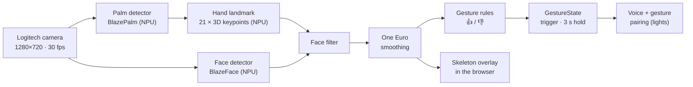
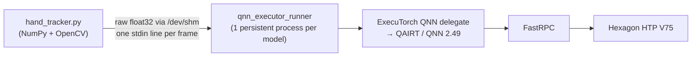

# Hand Gesture Detection — Algorithms, Models, Libraries and Packages

This document details the **hand gesture detection** part of the project: which models, algorithms, libraries and
Arduino VENTUNO tools are used, and how they fit together. For the overall system see
[architecture.md](architecture.md) and the [architecture diagram](architecture_diagram.pdf).

> **In short:** no ready-made Arduino VENTUNO gesture library is used. Gesture detection is built from
> **MediaPipe hand and face models**, exported with **ExecuTorch** to run on the VENTUNO Q's **Qualcomm Hexagon
> NPU**, plus the project's own **tracking and gesture-rule code**. Arduino's VENTUNO tools (**App Lab**) are used
> for the **voice** side only.

---

## **1. Pipeline at a Glance**

| Stage | Runs on | File |
|---|---|---|
| Palm detector, hand landmark, face detector | **Hexagon NPU** (ExecuTorch QNN) | `hand_tracker.py` |
| Decoding, tracking, face filter, smoothing | Kryo CPU (NumPy + OpenCV) | `hand_tracker.py` |
| Gesture rules + timing | Kryo CPU | `gestures.py` |
| Voice + gesture pairing | Kryo CPU | `camera_stream.py` |

---

## **2. Neural Models (Hand Gesture Detectors)**

All models take an RGB float32 tensor `(1, 3, 256, 256)` in `[0, 1]` and are quantized to **16a8w**
(16-bit activations, 8-bit weights) for the NPU. Every operator runs on the NPU (0 CPU fallback ops).

| Model | What it does | Outputs | NPU latency | CPU fp32 | Source | Used live |
|---|---|---|---|---|---|---|
| **MediaPipe BlazePalm** (palm detector) | Finds hands: palm boxes + 7 palm keypoints | `1×2944×18` boxes, `1×2944×1` scores | **1.42 ms** | 116 ms | Google MediaPipe, via `MediaPipePyTorch` (the version pinned by Qualcomm AI Hub) | Yes |
| **MediaPipe BlazeHandLandmark** | 21 3D keypoints for one hand crop | hand flag, handedness, `1×21×3` | **1.39 ms** | 75 ms | same | Yes |
| **MediaPipe BlazeFace** (back, 256×256) | Finds faces so they are not tracked as hands | `1×896×16` boxes, `1×896×1` scores | **1.3 ms** | — | same | Yes |
| **RTMPose-m hand** (`rtmpose-m_hand5_256`) | Alternative 21-keypoint model (SimCC heads) | x / y SimCC vectors | 6.16 ms | 88 ms | OpenMMLab RTMPose, pure-PyTorch port (`rtmpose_hand.py`) | No, benchmark only |

Exported model files on the board (`/home/arduino/handpose/export/pte/`):
`mp_palm_detector_qnn_16a8w.pte`, `mp_hand_landmark_qnn_16a8w.pte`, `mp_face_detector_qnn_16a8w.pte`
(plus `*_xnnpack_fp32.pte` CPU versions and the RTMPose files used for comparison).

### Keypoint layout (MediaPipe hand topology)

| Index | Points |
|---|---|
| 0 | Wrist |
| 1–4 | Thumb: CMC, MCP, IP, tip |
| 5–8 | Index finger: MCP, PIP, DIP, tip |
| 9–12 | Middle finger |
| 13–16 | Ring finger |
| 17–20 | Pinky |

---

## **3. Algorithms**

### **3.1 Two-Stage Hand Tracking** (`hand_tracker.py`)

MediaPipe-style detect-then-track loop, for up to **2 hands**:

1. **Letterbox** the frame to 256×256 (keeps the aspect ratio).
2. **Palm detection** runs only while fewer than 2 hands are tracked, plus a re-check every **15 frames**
   (`REDETECT_EVERY`). This keeps the detector mostly idle.
3. **Anchor decoding + non-maximum suppression**: 2944 SSD-style anchors are decoded into boxes; detections
   with score ≥ **0.7** are kept and overlapping ones (IoU > **0.3**) merged.
4. **Rotated crop** per hand: from the palm box (new hand) or from the previous frame's landmarks (tracked hand),
   rotated so the hand points up.
5. **Hand landmark model** on each crop → 21 3D keypoints and a hand-presence flag (kept if ≥ **0.5**).
6. **Fist retry**: BlazePalm boxes fists and thumbs-up hands too tightly, so a new detection that the landmark
   model rejects is retried with **1.6×** and **2.5×** larger crops.

### **3.2 Face Filter** (`hand_tracker.py`)

Stops the skeleton from appearing on a face when no hand is in view:

- BlazeFace runs every **2nd frame** (faces move slowly); faces with score ≥ **0.6** are kept.
- Each face box is enlarged (35% upward for the forehead, 10% to the sides and down).
- A hand is **rejected if more than 60%** of its 21 keypoints fall inside a face box.

Measured: 0 false hands over 595 live frames with a face in view.

### **3.3 One Euro Filter** (`hand_tracker.py`)

Adaptive low-pass filter on each keypoint: strong smoothing when the hand is still (removes jitter), little
smoothing when it moves fast (no lag). Settings: `min_cutoff = 1.0`, `beta = 30.0`, `d_cutoff = 1.0`.

### **3.4 Thumbs Up / Thumbs Down Rules** (`gestures.py`)

The gestures are **geometric rules on the 3D keypoints**, not a trained classifier, so no training data is
needed, and they work at any hand size, distance or position in the frame. Thumbs up and thumbs down use the same
test with the direction flipped.

| Check | Rule |
|---|---|
| Thumb straight | Bend at the IP joint < 45° and at the MCP joint < 55° |
| Thumb long | Thumb MCP → tip > 0.45 × palm size (wrist → middle-finger knuckle) |
| Thumb vertical | Within **60°** of straight up (👍) or straight down (👎) |
| Thumb beyond the fist | Tip beyond all knuckles and the wrist, and > 0.3 × palm size past the fist center |
| Fist | At least **3 of 4** fingers curled (combined PIP + DIP bend > 100°, or tip folded back toward the palm), and **no** finger clearly extended |

### **3.5 Gesture Timing** (`GestureState` in `gestures.py`)

| Setting | Value | Purpose |
|---|---|---|
| Trigger | **5 of the last 10 frames** (~0.3 s) | Ignores single-frame noise |
| Hold | **3 seconds** | Gesture stays active, then resets to *none* |
| Re-trigger | Gesture must be absent **0.4 s** first | Holding a thumb doesn't repeat the action |
| Switch | Instant | 👍 → 👎 (or back) takes over immediately |

### **3.6 Voice + Gesture Pairing** (`camera_stream.py`)

"Hey Arduino / Hey Ardy, **light**" plus a thumb within **3 seconds**, in either order or while the thumb is
held: 👍 turns the lights **on**, 👎 turns them **off**.

---

## **4. How the Models Run on the NPU**

- Each model runs in its own **persistent `qnn_executor_runner`** process (`--input_list_path=-`), so the QNN
  context stays loaded on the NPU and there's no per-frame start-up cost.
- Frames go in and outputs come back as raw float32 files in `/dev/shm` (RAM).
- The live tracker needs **no PyTorch**: only NumPy, OpenCV and the ExecuTorch runner.
- Result: the full pipeline keeps up with the camera at **~30 fps** (13–21 ms per frame).

---

## **5. Libraries and Packages**

### **5.1 Used for Hand Gesture Detection**

| Package | Version | Used for | When |
|---|---|---|---|
| **ExecuTorch** (Qualcomm QNN backend) | source, commit `5249a13c55` | Export to `.pte` and on-device runtime (`qnn_executor_runner`) | Export + live |
| ExecuTorch XNNPACK backend | same | CPU fp32 versions for accuracy / speed comparison | Export |
| **Qualcomm QAIRT / QNN** (`qairt-libs`, `qairt-dsp-binaries`, `libqnn1`, `qnn-tools`) | 2.49.0 | NPU runtime (`libQnnHtp`) | Live |
| **qcom-fastrpc1** | 1.0.15 | CPU ↔ Hexagon DSP calls | Live |
| **PyTorch** | 2.13.0 (CPU) | Model definitions, `torch.export`, 16a8w quantization (`QnnQuantizer`) | Export only |
| torchvision / torchao | 0.28.0 / 0.18.0 | Export dependencies | Export only |
| **NumPy** | 2.4.4 | Anchor decoding, NMS, crops, keypoint math, gesture geometry | Live |
| **OpenCV** (headless) | 5.0.0 | Camera capture (V4L2), resize, letterbox, rotated crops, JPEG | Live |
| MediaPipePyTorch | Qualcomm AI Hub pin | BlazePalm / BlazeHandLandmark / BlazeFace code, weights, anchors | Export |

### **5.2 Arduino VENTUNO Tools**

| Tool | Used for |
|---|---|
| Arduino App Lab (`arduino-app-cli` 0.13) | Runs the **voice** app |
| `arduino:keyword_spotting` brick | "Hey Arduino" / "Hey Ardy" wake word (voice) |
| `arduino:asr` brick | Whisper Small speech recognition on the NPU (voice) |

None of the Arduino App Lab modules are used for hand gestures. The gesture side is ExecuTorch + MediaPipe +
project code.

---

## **6. Source Files**

| File | Contents |
|---|---|
| [`device/handpose/hand_tracker.py`](../device/handpose/hand_tracker.py) | NPU runners, palm / landmark / face decoding, tracking, face filter, One Euro filter |
| [`device/handpose/gestures.py`](../device/handpose/gestures.py) | Thumbs up / down rules and `GestureState` |
| [`device/handpose/camera_stream.py`](../device/handpose/camera_stream.py) | Camera, tracking loop, voice + gesture pairing, HTTP API |
| [`device/handpose/hand_models.py`](../device/handpose/hand_models.py) | PyTorch model factory and reference pipeline (export) |
| [`device/handpose/export_lib.py`](../device/handpose/export_lib.py), [`step2_export.py`](../device/handpose/step2_export.py), [`export_face.py`](../device/handpose/export_face.py) | ExecuTorch export and validation |
| [`device/handpose/rtmpose_hand.py`](../device/handpose/rtmpose_hand.py) | RTMPose hand (comparison model) |
| [`device/handpose/test_gestures.py`](../device/handpose/test_gestures.py), [`probe_false_hands.py`](../device/handpose/probe_false_hands.py) | Gesture rule tests and false-hand probe |
