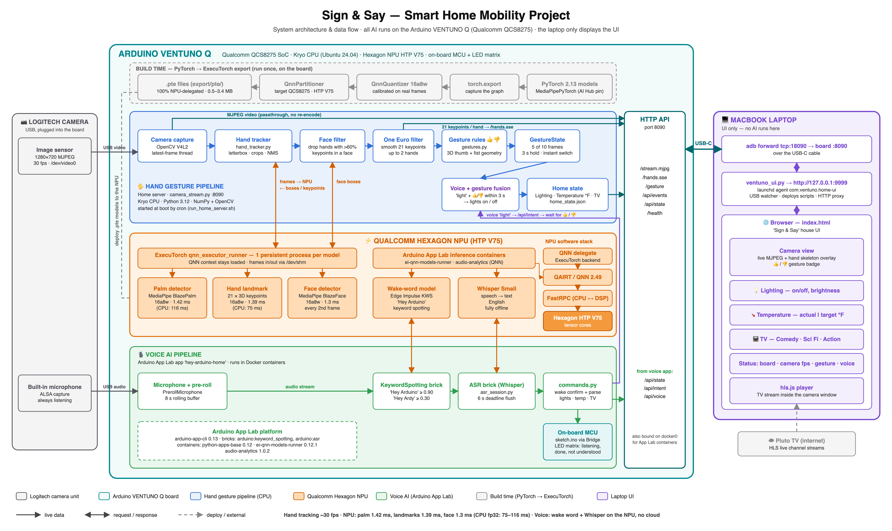
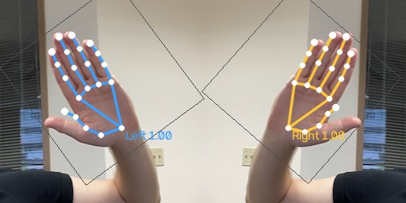

# Hey Ardy

**Control your home with your voice and your hands — fully offline, on the edge.**

Hey Ardy runs a smart-home controller for **lighting, temperature and TV** on an
**Arduino VENTUNO Q** (Qualcomm QCS8275). Real-time hand tracking and gesture recognition run on the board's
**Qualcomm Hexagon NPU** through **ExecuTorch**, and "Hey Arduino" voice commands are recognized on-device with
**Whisper**. No cloud, no internet needed for the AI. A laptop browser shows the live home dashboard.

Built for the ExecuTorch Hackathon SF 2026, with mobility and accessibility in mind: people who can't easily reach
switches or remotes can control their home with a short phrase, a thumb gesture, or both.



---

## Features

| | Feature | How to use it |
|---|---|---|
| 💡 | **Lighting** | "Hey Arduino, turn on the light", "lights 40 percent", "dim the lights", or **"Hey Arduino, light" + 👍 / 👎** |
| 🌡️ | **Temperature (°F)** | "Hey Arduino, set the temperature to 72", "warmer", "cooler", "set the temperature to 22 celsius" (converted) 
| 📺 | **TV with 3 live channels** | "Hey Arduino, turn on the TV", "channel 2", "comedy", "sci fi", "action", "next channel", "volume 20" |
| 👍 👎 | **Gesture recognition** | Thumbs up / thumbs down, any hand position, loose or tight fist, instant up ↔ down switching, 3 s hold |
| 🗣️ + ✋ | **Voice + gesture together** | Say "light" and show a thumb within 3 seconds (in either order) to switch the lights on or off |
| 🎙️ | **Two wake phrases** | "Hey Arduino" or "Hey Ardy" |
| 🙂 | **No false hands on faces** | An NPU face detector filters out faces mistaken for hands |
| 🔒 | **Private and offline** | Camera, microphone and all AI stay on the board |

**Live TV:** when the TV is on, the selected Pluto TV channel (Comedy, Sci Fi, Action) plays inside the camera
window. Turning it off switches straight back to the camera with hand tracking reset. Changing channels while the
TV is off shows a "TV is off" message.

---

## How it works

| Component | Role |
|---|---|
| **Logitech USB camera** (plugged into the board) | Video for hand tracking + microphone for voice |
| **Arduino VENTUNO Q** | Runs everything: camera capture, NPU hand tracking, gestures, wake word, Whisper speech recognition, command parsing, home state |
| **Laptop browser** | Shows the "Hey Ardy" house dashboard at `http://127.0.0.1:9999`, connected to the board over USB-C |

**Hand pipeline (NPU via ExecuTorch):** MediaPipe palm detector → hand landmark model (21 3D keypoints) → face
filter → smoothing → rule-based 👍 / 👎 classifier. The models were exported from PyTorch with ExecuTorch's
Qualcomm QNN backend (16-bit activations, 8-bit weights), 100% delegated to the NPU.

| Model | CPU (fp32) | **Hexagon NPU (16a8w)** |
|---|---|---|
| Palm detector | 116 ms | **1.42 ms** |
| Hand landmark | 75 ms | **1.39 ms** |
| Face detector | — | **1.3 ms** |

**Voice pipeline (Arduino App Lab):** keyword spotting ("Hey Arduino" / "Hey Ardy") → Whisper Small speech
recognition on the NPU → offline command parser → home server. Based on Arduino's
[VENTUNO Q Local AI Assistant](https://docs.arduino.cc/tutorials/ventuno-q/local-ai-assistant/) tutorial, without
the LLM and text-to-speech.

<p align="center">
  
  <br><em>Two hands tracked by the exported models running on the Hexagon NPU</em>
</p>

---

## Getting started

### Requirements

- Arduino VENTUNO Q with Arduino App Lab, ExecuTorch (Qualcomm backend) and the exported models
  (see the full setup guide)
- Logitech USB webcam with a built-in microphone, plugged into the board
- A Mac connected to the board with USB-C, with `adb` (`brew install android-platform-tools`)

### Quick start

```bash
git clone https://github.com/dev1-popaisle/ExecuTorch-Hackathon-SF2026.git
cd ExecuTorch-Hackathon-SF2026

adb devices                      # the VENTUNO Q should be listed
bash mac/install.sh              # installs the UI agent; opens http://127.0.0.1:9999 when the board is connected

adb shell arduino-app-cli app start user:hey-arduino-home   # start the voice app (if not already running)
```

Then say **"Hey Arduino, turn on the light"**, or say **"Hey Arduino, light"** and show a 👍.

The board's home server starts by itself at boot, so voice and gestures work even when the laptop is unplugged.

📘 **Full guide:** [Documentation/GETTING_STARTED.md](Documentation/GETTING_STARTED.md): first-time board setup,
model export, deploying changes, tests, troubleshooting and the HTTP API.

---

## Documentation

| Document | Contents |
|---|---|
| [Getting Started](Documentation/GETTING_STARTED.md) | Setup, usage, deployment, tests, troubleshooting |
| [Architecture](Documentation/architecture.md) | Components, flow diagrams, models, NPU usage, PyTorch / ExecuTorch, packages |
| [Architecture diagram (PDF)](Documentation/architecture_diagram.pdf) · [SVG](Documentation/architecture_diagram.svg) | One-page system diagram |

---

## Repository layout

```
├── device/
│   ├── handpose/        runs on the board: home server, NPU hand tracker, gestures, model export scripts
│   └── voice_app/       Arduino App Lab app "hey-arduino-home" (wake word + Whisper + command parser)
├── mac/                 laptop UI: launchd agent, house dashboard (index.html), installer
├── Documentation/       guides and architecture diagram
└── results/             export reports (accuracy vs PyTorch, latency) and sample outputs
```

---

## Tech stack

**Arduino VENTUNO Q** (Qualcomm QCS8275, Hexagon NPU HTP V75, Ubuntu 24.04) · **ExecuTorch** with the Qualcomm
QNN backend · **QAIRT / QNN 2.49** · **PyTorch 2.13** · **MediaPipe** BlazePalm, BlazeHandLandmark, BlazeFace ·
**Arduino App Lab** keyword spotting + Whisper ASR bricks · NumPy · OpenCV · `hls.js` · Pluto TV

## Acknowledgements

- [ExecuTorch](https://github.com/pytorch/executorch) and its Qualcomm backend
- MediaPipe hand and face models via [MediaPipePyTorch](https://github.com/zmurez/MediaPipePyTorch), as used by
  Qualcomm AI Hub
- [Arduino VENTUNO Q Local AI Assistant](https://docs.arduino.cc/tutorials/ventuno-q/local-ai-assistant/)
  (Arduino's example app is not included in this repo)
- Live channels from [Pluto TV](https://pluto.tv)
